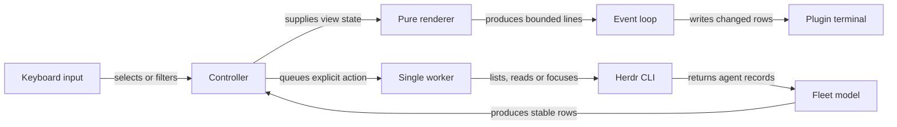

# How Fleet works

Fleet renders an agent tree in a plugin-owned interactive pane. Herdr owns agent detection, session state and actual focus. Fleet observes that state and holds its display state in memory.

For example, selecting a Codex agent in the `API` tab and pressing Enter queues one `agent focus` request. The background worker performs it; a successful response exits the event loop, and the terminal context restores the original input settings and screen. A failed focus leaves the dashboard open with an inline error. This path is covered with fake clients and a real PTY; native focus after popup exit is checked manually.

## Components

| Source | Responsibility |
| --- | --- |
| [client.py](../src/herdr_fleet/client.py) | Injectable subprocess runner, two-second timeouts, response validation, explicit list/snapshot/read/focus commands and own-pane launch |
| [model.py](../src/herdr_fleet/model.py) | Atomic agent updates, stable insertion order, observed state ages, jump codes, tree rows and ranked agent rows |
| [controller.py](../src/herdr_fleet/controller.py) | Keyboard actions, selection, collapse/filter state, scroll visibility and preview lifetime |
| [renderer.py](../src/herdr_fleet/renderer.py) | Pure model-to-lines rendering, responsive preview placement and changed-row comparison |
| [app.py](../src/herdr_fleet/app.py) | Scheduling, one background worker, polling, queued focus/peek actions and terminal writes |
| [terminal.py](../src/herdr_fleet/terminal.py) | Raw input, incremental UTF-8 and escape decoding, size detection and terminal restoration |
| [text.py](../src/herdr_fleet/text.py), [theme.py](../src/herdr_fleet/theme.py) | Control stripping, cell-aware clipping and theme/color selection |
| [prefs.py](../src/herdr_fleet/prefs.py) | Allowlisted UI preferences, validated opaque group IDs and atomic preference writes |
| [search.py](../src/herdr_fleet/search.py) | Deterministic case-insensitive subsequence scoring |

## Data and execution flow

The worker performs one agent-list call per interval, default one second with a 500 ms floor. Label snapshots refresh separately about every 30 seconds. Input and rendering continue while CLI work runs. Only one operation runs at a time, so a slow request can delay the next poll or queued action, bounded by the client timeout. Explicit focus and preview requests take priority when the worker becomes free.

The model validates a whole list before replacing its records. Existing panes retain insertion rank and jump code across reordered payloads. A status, sequence, agent-type or session change resets the observed age and starts a two-second highlight. New records have unknown state ages. A duration is shown only after an observed change, and a session replacement resets age knowledge. Herdr supplies no timestamp.

Normal tree search uses a substring over title, workspace, tab and type. Fuzzy mode scores separate fields and their combined text, favors early/consecutive/word-boundary matches and breaks ties with insertion rank. It is a greedy subsequence matcher, not fzf's algorithm. Fuzzy search additionally includes cwd.

## Rendering and privacy boundaries

The renderer emits complete line strings; the app writes only rows different from the previous frame. Entry and resize clear the screen. Spinners update from the local clock without extra CLI requests. Up to four attention entries stay pinned when there is enough vertical space; all matching agents remain reachable in the tree.

Preview content comes only from an explicit `agent read` request. It is discarded on dismissal, selection change, replacement and exit. The generation counter prevents an old asynchronous preview response from replacing a newer selection. Rendering strips terminal control sequences. Unicode width uses the standard library's combining and East Asian width properties; complex emoji sequences can still differ across terminal fonts.

Only `poll_interval` and validated collapsed group IDs can reach `preferences.json`. Agent records, titles, paths, queries, session identities and output have no disk persistence path. Generic errors suppress raw CLI diagnostics. Both stdout and stderr of CLI requests are captured in memory.

The registered actions in [herdr-plugin.toml](../herdr-plugin.toml) launch the interactive dashboard through `plugin pane open`. Action command output cannot host raw-mode input. The plugin guards entry with `HERDR_ENV=1`; it never invents session variables or connects to another session.

## Failure and compatibility

Bad data or unavailable Herdr keeps the last valid model visible and polling retries. Label failures fall back to IDs. Explicit focus failures remain actionable without closing. Exit paths restore termios attributes, signal handlers, cursor, wrapping and alternate screen; SIGKILL cannot be caught. In-flight worker calls can finish after exit begins, bounded by their timeout.

The plugin targets the Herdr 0.9.5 plugin API. Linux runtime behavior, persistent placements and popup focus are not covered by the automated tests. See [verification](VERIFICATION.md) for test coverage and the manual checks.
